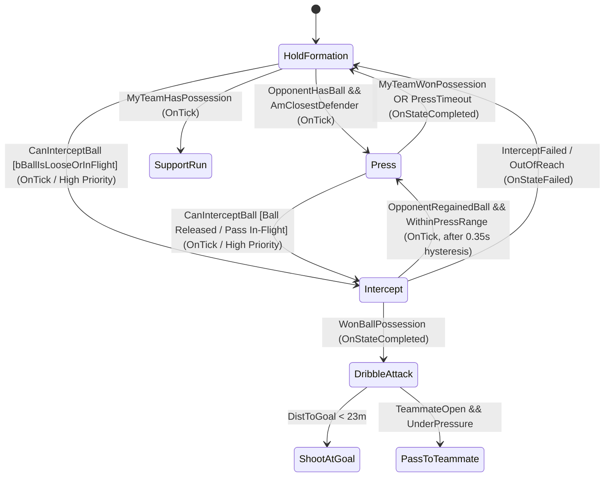

# Revisão Técnica do StateTree de IA Tática — Correção do Travamento `Press -> Intercept`

## 1. Diagnóstico do Problema
No **Unreal Engine 5.8 StateTree**, quando um jogador de futebol defensivo está no estado **`Press`** (pressionando o portador da bola) e o adversário solta um passe ou adianta a bola, a transição para **`Intercept`** frequentemente **trava** (o defensor continua correndo atrás do ex-portador em vez de cortar a linha de passe).

Identificamos **4 causas-raiz** clássicas na arquitetura do StateTree do UE5:

| # | Causa-Raiz no StateTree | Sintoma Observado | Correção Implementada no `FootballCoreAI` |
|---|---|---|---|
| **1** | **Trigger errado (`OnStateCompleted` em vez de `OnTick`)** | A Task `Press` retorna `EStateTreeRunStatus::Running` continuamente enquanto persegue o portador. Transições marcadas como `OnStateCompleted` **nunca disparam** porque o estado nunca termina! | Configuramos a transição como **`OnTick`** com prioridade `High` **E** fazemos a Task `FFootballTask_PressCarrier::Tick` retornar `Succeeded` assim que `bBallIsLooseOrInFlight == true` (dupla proteção!). |
| **2** | **Bindings congelados (Evaluator sem `Tick` ou Task sem `bShouldCopyBoundPropertiesOnTick`)** | A condição `CanInterceptBall` lê `BallVelocity` e `PredictedInterceptPoint` desatualizados do momento em que a árvore iniciou. | Criamos `FFootballTacticalEvaluator::Tick` atualizando o `FFootballTacticalContext` todo frame e forçamos `bShouldCallTick = true` e `bShouldCopyBoundPropertiesOnTick = true` no construtor da Task. |
| **3** | **Falta de Gate de Bola Solta + Histerese** | `Press` e `Intercept` disputam a mesma distância da bola; sem margem de histerese (`InterceptTimeMarginSec`), o jogador oscila ou falha na condição de entrada de `Intercept` e volta preso para `Press`. | `FFootballCond_CanInterceptBall` exige explicitamente `bBallIsLooseOrInFlight == true` + `TimeToReachInterceptSec <= BallTimeToInterceptSec + 0.20s` (usando trajetória **Magnus** prevista!). |
| **4** | **Ausência de Timeout de Segurança (Deadlock)** | Se o adversário driblar fora da zona de pressão ou um `MoveTo` travar no NavMesh, o defensor fica eternamente em `Press`. | `FFootballTask_PressCarrier` possui `MaxPressDurationSec = 4.5f`, devolvendo o controle para a árvore tática reavaliar. |

---

## 2. Fluxo Corrigido do StateTree Tático

---

## 3. Como Configurar no Editor de StateTree da UE 5.8.4 (Passo a Passo)

Todos os nós em C++ já estão prontos em `Plugins/FootballCore/Source/FootballCoreAI/Public/FootballTacticalStateTree.h`!

1. No Content Browser da UE 5.8.4, clique direito → **Artificial Intelligence → StateTree** e nomeie `ST_CraquezTacticalAI` (Schema: **StateTreeAIComponent**).
2. Em **Evaluators**, adicione **`Craquez Tactical Evaluator`** (`FFootballTacticalEvaluator`) e faça bind de `FootballPlayer` ao `AIController -> ControlledPawn`.
3. Crie dois estados filhos de `Defending`: **`Press`** e **`Intercept`**.
4. No estado **`Press`**:
   - Adicione a Task **`Craquez: Press Ball Carrier`** (`FFootballTask_PressCarrier`).
   - Faça bind de `TacticalContext` → `Craquez Tactical Evaluator.TacticalContext`.
   - Em **Transitions**, adicione uma transição para **`Intercept`**:
     - **Trigger**: `On Tick` *(NUNCA deixe apenas `On State Completed`!)*
     - **Priority**: `High`
     - **Condition**: `Craquez: Can Intercept Ball (Press->Intercept Fix)` (`FFootballCond_CanInterceptBall`), com `TacticalContext` bindado ao Evaluator.
5. No estado **`Intercept`**:
   - Adicione a Task **`Craquez: Intercept Predicted Ball`** (`FFootballTask_InterceptBall`).
   - Em **Transitions**, adicione `On State Succeeded` → `Attacking` e `On State Failed` → `Defending`.
6. No seu Blueprint derivado de `AFootballAIController`, marque `bUseExternalStateTreeAsset = true` e selecione `ST_CraquezTacticalAI` no `TacticalStateTreeComponent`.

> **Nota para iniciantes**: Mesmo antes de criar esse asset visual no editor, o `AFootballAIController` já roda nativamente em C++ exatamente essa máquina de estados corrigida (com `Press -> Intercept` funcionando nos modos **11v11** e **1v1**)!
