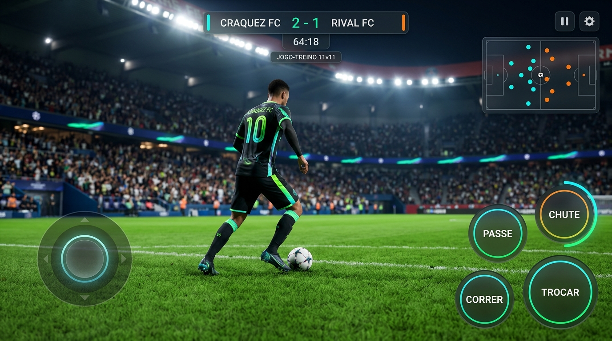
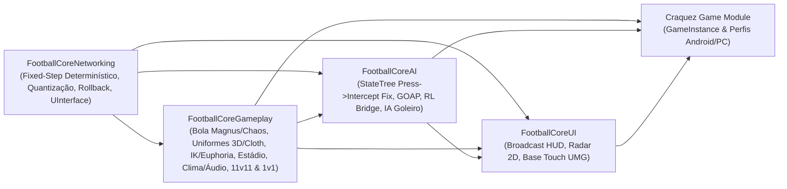

<div align="center">


<br/>


# CRAQUEZ — Futebol 3D Realista (Unreal Engine 5.8.4)

**Piloto Mobile-First para Android (ARM64 / Vulkan) preparado para escalar para PC & Consoles.**  
*11vs11 (Jogo-Treino) • 1vs1 (Atacante x Goleiro) • Física de Bola Magnus (Chaos) • IA Tática StateTree + GOAP • Uniformes 3D Separados com Cloth • Shaders GPU*

</div>

---

## Visão Geral do Projeto

O **Craquez** foi arquitetado desde o primeiro dia com uma base profissional e modular em **Unreal Engine 5.8.4** usando o plugin proprietário **`FootballCore`**, permitindo jogar e evoluir imediatamente mesmo para quem está abrindo a UE5 pela primeira vez.

### O que já está implementado e pronto neste repositório
- **Plugin Modular `FootballCore`** com 4 módulos desacoplados (`Build.cs` individuais para UE 5.8.4):
  1. `FootballCoreNetworking` — Simulação determinística em fixed-step (`60 Hz`), vetores quantizados (`1 mm`) com `NetSerialize`, PRNG determinístico, ring-buffer de snapshots (rollback/replay) e interface Blueprint (`IFootballDeterministicReplica`).
  2. `FootballCoreGameplay` — Física real da bola FIFA nº 5 (**Efeito Magnus**, arrasto quadrático, vento, grama molhada, **deformação elástica** no impacto, colisão contínua CCD), uniformes 3D separados (`UFootballUniformComponent` com suporte a **Chaos Cloth** + LOD mobile), animação procedural (`UFootballProceduralAnimComponent` com **Foot IK**, **Motion Warping**, **Motion Matching** e reações **Euphoria**), gerador procedural de **Estádio Low-Poly**, sistema dinâmico de **Clima** e **Áudio Posicional 3D**, além dos modos **11vs11 (Jogo-Treino)** e **1vs1 (Atacante x Goleiro)**.
  3. `FootballCoreAI` — IA tática com **StateTree UE 5.8** (incluindo a **correção definitiva do travamento na transição `Press -> Intercept`**), **GOAP Planner**, ponte pronta para **Reinforcement Learning (RL)** e **IA de Goleiro** com previsão de trajetória curvada por Magnus.
  4. `FootballCoreUI` — HUD Neon Broadcast funcional imediatamente (`Placar`, `Relógio`, `Mini-Radar 2D ao vivo` com os 22 jogadores e a bola, `Barra de Estamina e Força/Curva`) + classe base UMG (`UFootballHUDWidget`) pronta para botões Touch no Android.
- **Shaders HLSL / Compute Shaders GPU** (`Plugins/FootballCore/Shaders/`): Grama reativa a vento/chuteiras, deformação WPO da bola e torcida GPU sem ossos (20.000+ torcedores a 60 FPS).
- **Gerador Procedural de Uniformes 3D para Blender** (`Tools/blender_generate_kit_meshes.py`): gera malhas `.fbx` separadas (camisa, calção, meião, chuteira, bola) para nunca pintar uniforme na pele!

---

## Conceito de Interface Mobile (Android)

<div align="center">
  
</div>

---

## Arquitetura do Plugin `FootballCore`



---

## Guias e Documentação Inclusos

1. **[Guia Completo para Iniciantes na UE 5.8.4 + Android](Docs/GUIA_INICIANTE_UE5_8.md)** — Do zero até abrir o projeto, jogar `11v11` / `1v1` e gerar seu primeiro `.apk`.
2. **[Revisão do StateTree de IA Tática (`Press -> Intercept` Fix)](Docs/STATETREE_PRESS_INTERCEPT_FIX.md)** — Diagnóstico das 4 causas de travamento e solução completa em C++ e no Editor.
3. **[Assets 100% Gratuitos e Pipeline de Uniformes 3D Reais](Docs/ASSETS_GRATUITOS_E_UNIFORMES.md)** — MetaHuman, Mixamo, Quixel/Fab, PolyHaven, Freesound CC0 e Chaos Cloth.
4. **[Arquitetura Avançada UE 5.8.4](Docs/ARQUITETURA_AVANCADA_UE5.md)** — Niagara + Compute Shaders, Control Rig/Motion Warping/Euphoria, Chaos Physics, MetaHuman e PCG.

---

## Estrutura de Pastas

```text
Craquez3D-Neon/
├── Craquez.uproject                  # Projeto UE 5.8.4 (Android + Windows)
├── Art/                              # Arte visual, logo, conceito de HUD e malhas FBX 3D
├── Config/                           # Configurações Android Vulkan, Chaos Determinístico e Escalabilidade
├── Docs/                             # Manuais completos em Português
├── Tools/                            # Script Blender para gerar malhas 3D separadas dos uniformes
├── Source/Craquez/                   # Módulo principal do jogo
└── Plugins/FootballCore/             # Plugin modular FootballCore
    ├── FootballCore.uplugin
    ├── Shaders/                      # Compute Shaders & HLSL (Grama, Torcida GPU, Deformação Bola)
    └── Source/
        ├── FootballCoreNetworking/   # Replicação determinística & Blueprint Interface
        ├── FootballCoreGameplay/     # Física Magnus, Uniformes Cloth, IK, Estádio, Clima, Áudio
        ├── FootballCoreAI/           # StateTree (Fix Press->Intercept), GOAP, RL & Goleiro
        └── FootballCoreUI/           # HUD Broadcast, Radar 2D & UMG Touch Android
```
